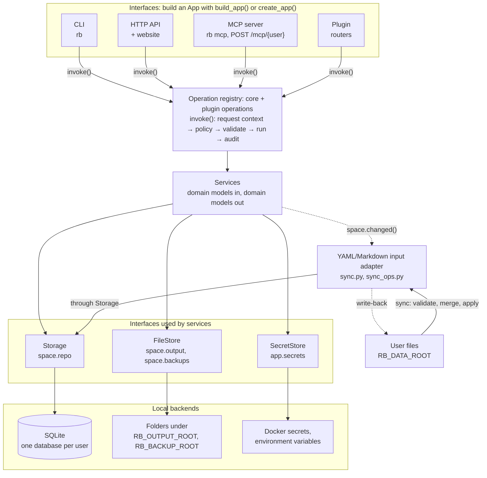
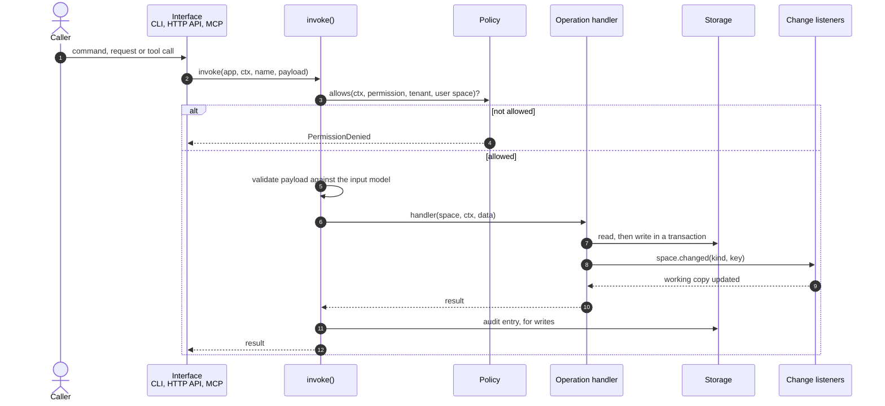
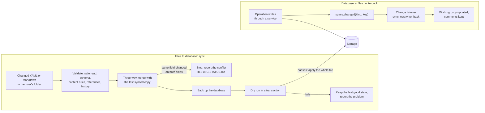
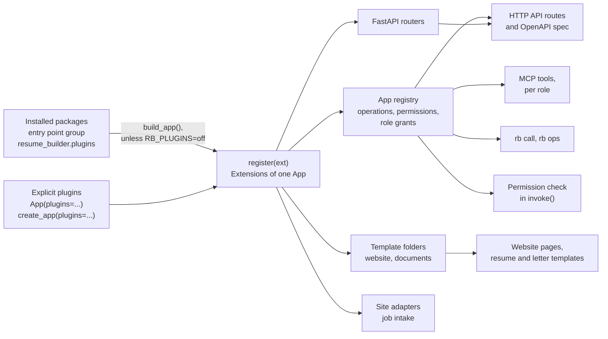

# Architecture and extension points

This page is for contributors and for anyone building on resume-builder as a library. It explains how the code is layered and how an outside package can add features without editing core files. The product rules behind it are in [PRD.md](PRD.md), section 9.

## Layers



Every operation is defined once and reaches every interface from that one definition. Interfaces only say who is calling; the policy decides what they may do. Services never open files, parse YAML or run SQL.

## One request, end to end

The same path runs for a CLI command, an HTTP request, an MCP tool call or a plugin route:



Interfaces only build the request context: actor, roles, user space and tenant. The policy and the audit log sit inside `invoke()`, so no interface can skip them.

Only writes get an audit entry. For calls by the `agent` actor, reads included, `invoke()` also records when the agent was last seen on that channel (`services/agent_status.note_seen`, at most once a minute, in storage meta). The website's agent status uses it. This bookkeeping never fails the call.

## Building an App

`App` holds everything one host process shares: settings, the operation registry, the policy, plugins, and the factories for storage and file stores. Nothing is created at import time.

- `resume_builder.space.build_app(settings=None, **options)` is what the CLI, `rb serve` and `rb mcp` use. It loads installed plugins unless `RB_PLUGINS=off`.
- `resume_builder.web.app.create_app(app=None, **options)` returns the FastAPI app (HTTP API plus website). Without an `app` it calls `build_app` with the same options.

```python
from resume_builder.web.app import create_app

api = create_app(
    plugins=[my_plugin],                 # operations, permissions, routers, template folders
    routers=[extra_router],              # more FastAPI routers
    template_dirs=["my_web_templates"],  # searched before the packaged website templates
    storage_factory=my_storage,          # (app, user_id) -> Storage
    file_store_factory=my_files,         # (app, user_id, area) -> FileStore
    secrets=my_secret_store,             # SecretStore
    change_listeners=[],                 # no YAML write-back (for example, no user files)
    web_hosts=["tracker.example.com"],   # host names the website and API answer to
    fetcher=my_fetcher,                  # PostingFetcher for job intake (for example, through a proxy)
    tenant_id="local",                   # the tenant this App serves
)
```

| Option | What it is | Local default |
| --- | --- | --- |
| `plugins` | Objects with `register(ext)`, or callables taking `ext` | Installed entry points (`build_app` only) |
| `routers` | FastAPI `APIRouter`s | none |
| `template_dirs` | Website template folders, checked before the package's | none |
| `document_template_dirs` | Extra resume and letter template roots | none |
| `storage_factory` | `(app, user_id) -> Storage` | `storage.sqlite_storage`: `RB_DB_ROOT/<user>/app.db` |
| `file_store_factory` | `(app, user_id, area) -> FileStore`, `area` is `output` or `backups` | `filestore.local_file_store` |
| `secrets` | A `SecretStore` | `secretstore.EnvSecretStore` |
| `change_listeners` | Callables `(space, Change) -> bool` | `[sync_ops.write_back]` |
| `web_hosts` | Host names the website and API answer to. Every request with another `Host` is refused before any route runs (against DNS rebinding, PRD R8.9). Given a list, only those names work | `localhost`, `127.0.0.1`, `::1`, plus `RB_WEB_HOSTS` |
| `fetcher` | A `fetch.PostingFetcher`: `fetch(url, limits) -> FetchedPage`, for job intake (PRD 8.13) and importing a resume from a link (R2.11). A replacement must keep R13.5–R13.8: one GET, no cookies or user data, internal addresses refused on every redirect, timeout and size limit | `fetch.HttpPostingFetcher` |
| `policy` | A `Policy` | the process-wide `RolePolicy` |
| `tenant_id` | The tenant of the user spaces this App serves | `"local"` |

## The extension points

### 1. Operations and permissions (`operations.py`, `plugins.py`)

An operation is a function `handler(space, ctx, data)` with a typed Pydantic input model, a permission and a summary. Core operations register into `operations.REGISTRY`. Each App works on its own copy, so plugins added to one App never appear in another.

A plugin declares any new permission (`area:action`), grants it to roles, and registers operations:

```python
from pydantic import BaseModel

class NoteIn(BaseModel):
    text: str

def register(ext):
    ext.add_permission("notes:write", roles=("owner",))
    ext.add_permission("notes:read", roles=("owner", "agent", "viewer"))

    @ext.operation("note_add", "notes:write", NoteIn, "Add a note.", writes=True)
    def note_add(space, ctx, data: NoteIn) -> dict:
        ...
```

From then on, the operation:

- is `POST /api/{user}/note_add` in the HTTP API and listed in the OpenAPI spec;
- is callable with `rb call note_add` and listed by `rb ops`;
- is an MCP tool for every role holding its permission (`mcp.tools_for(registry, role)`); the MCP server serves the `agent` role;
- runs only through `invoke()`, which checks the permission, validates the input and writes an audit entry for writes.

An operation that names an undeclared permission is refused at registration.

The MCP server (`mcp.McpServer`) has two transports with the same tools and the same handler:

- **stdio:** `rb mcp`, channel `mcp`. The assistant starts it as a process.
- **Streamable HTTP:** `POST /mcp/{user}` on the tracker (`api._mcp_http`), channel `mcp-http`. Every request needs an agent token (`Authorization: Bearer`, from `rb token --actor agent`); an owner token is refused. A foreign `Origin` is refused as well as a foreign `Host`, and bodies over a size limit are rejected. Answers are plain JSON: no event stream and no sessions, so `GET` and `DELETE` return 405. Like the rest of the site, it's reachable only on the host's `127.0.0.1`.

The server also answers `prompts/list` and `prompts/get` with the ready-made requests in `prompts.py`, which clients offer as slash commands. Prompts are a fixed list in core, not part of the registry: a plugin can't add one, and a prompt only asks the agent to call operations, which still go through `invoke()`.

### 2. Request context and policy (`security.py`)

Every call carries a `RequestContext`: `actor` (`owner`, `agent`, `system` or `anonymous`), `roles`, `user_id` (the user space), `tenant_id`, `channel` and `request_id`. Locally the user id is the folder name under `RB_DATA_ROOT`, and the tenant is always `"local"`.

`channel` says how the call arrived, and it's written to every audit entry:

| Channel | Where from |
| --- | --- |
| `cli` | `rb` commands, including drafts an agent pipes into `rb propose` |
| `api` | The HTTP API, `POST /api/{user}/<operation>` |
| `web` | Website pages, and the owner's signed-in `POST` actions |
| `mcp` | The MCP server over stdio (`rb mcp`) |
| `mcp-http` | The MCP server over HTTP (`POST /mcp/{user}`) |
| `yaml-sync` | Changes applied from the user's YAML and Markdown files |
| `bootstrap` | Container start: migrations and the first sync |

The agent status uses the channel to tell an assistant that reached the app itself (`mcp`, `mcp-http`, `api`) from drafts pasted through the CLI. A host adding an interface should give it its own channel name.

`authorize()` is the only permission check. It asks the policy, passing the App's role table, so plugin grants apply. `RolePolicy` allows a permission only when one of the context's roles holds it, and only in the context's own user space and tenant. A host can pass its own `Policy` to the App.

### 3. Storage (`storage.py`)

`Storage` is the interface services use through `space.repo`. It covers:

- the content library, organizations, applications and events;
- drafts waiting for the owner: event drafts, intake proposals (jobs an agent proposed) and application drafts (changes an agent proposed to a job's own fields);
- captured job postings, profiles, documents and snapshots;
- the audit log, sync state and tokens, plus the queries the agent status uses (`last_audit_at`, `audit_entries_by`, `active_token_created`, `replaced_token_actor`);
- website sign-in: sessions and one-time login codes, stored only as hashes.

It also has `transaction()`, `migrate()`, `dump()`, `load()` and `destroy()` (close and permanently delete the user's stored data, for `space_delete`). Rows come back as plain dicts.

`repositories.SqliteStorage` is the only implementation here: one database per user space, with migrations in `src/resume_builder/migrations/`. Each migration runs in one transaction. A migration that rebuilds a table other tables refer to (SQLite's documented table rebuild, as in `0004`) starts with the line `-- rb:foreign-keys-off`: the runner then switches foreign keys off for that migration only, runs `PRAGMA foreign_key_check` before committing (any broken reference rolls it back), and switches them back on. The migrations are SQLite SQL. Another backend ships its own schema and must keep the same guarantees: transactions are all or nothing, content is archived rather than deleted, events and posting captures are append-only, intake proposals and application drafts are kept and resolved once (pending to confirmed or discarded, never back, never deleted; `0003` and `0006` enforce this with triggers), sessions, login codes and tokens are stored only as hashes, a login code works once, and every record carries `created_by/at` and `updated_by/at`.

### 4. Input adapters and change notifications (`changes.py`, `sync.py`, `sync_ops.py`)

The YAML and Markdown files in a user's folder are an input adapter over the services. `sync.py` validates changed files and applies them to storage. `sync_ops.py` holds the file-facing operations (`space_init`, `space_delete`, `sync`, `resolve`, `export_files`, `profile_propose_text`, and `job_intake_preview_file` and `library_import_file`, which read a file the user saved in their intake folder and hand its text to the service) and the bootstrap.

Services never write those files. After a write they call `space.changed(kind, key)`, and every change listener on the App receives a `Change`. Locally that listener is `sync_ops.write_back`, which updates the working copy and keeps comments. A host without user files passes `change_listeners=[]`, or its own listeners.

Data moves both ways:



A file is applied whole or not at all. Write-back skips a file the user has edited since the last sync; the next sync merges those edits instead of overwriting them.

`layout.py` holds the folder layout as path labels. Services use it only to name a working copy in messages.

### 5. Settings and secrets (`config.py`, `secretstore.py`)

Process settings (`config.Settings`) come from `RB_*` environment variables. Per-user settings are the `UserSettings` model: read from `user.yaml` by the sync adapter, stored in storage, and read by services from there (`space.user_settings`).

`user.yaml` holds only the names of secrets, such as contact details and publish credentials. Values come from the App's `SecretStore`: `get(name, user_id=...)`. `EnvSecretStore` reads `/run/secrets/<name>` (or `RB_SECRETS_DIR`), then the environment variable. Values never reach storage or snapshots.

### 6. File stores (`filestore.py`)

Each user space has two `FileStore`s: `space.output` (exported PDFs and HTML and the static public site, all disposable) and `space.backups` (database backups). Keys are relative paths with `/`. `LocalFileStore` maps them to folders under `RB_OUTPUT_ROOT/<user>` and `RB_BACKUP_ROOT/<user>`.

### 7. Templates

- **Website:** Jinja uses a `ChoiceLoader` that checks the App's template folders (from `template_dirs` and `ext.add_template_dir`) before the packaged `web/templates`. A host can replace `base.html` or any page.
- **Documents:** a resume or letter template is a folder `<family>/<name>/<version>/` with `document.html.j2` and `style.css`. Extra roots (`document_template_dirs`, `ext.add_document_templates`) can add new templates or versions. They cannot replace a version that ships in the package: snapshots must regenerate byte for byte, so released versions never change.

### 8. Routers

`ext.add_router(router)` (or `create_app(routers=[...])`) includes a FastAPI router. Inside a route, `Depends(resume_builder.web.app.get_app)` gives the App. Routes that read or change data should call `invoke()` with a request context from `api.context_for(app, user, authorization)`, so they get the same permission checks as everything else. A website route that changes data must also follow PRD R8.9: a `POST` only, with `web.session.check_request_origin` and `check_csrf` against the owner's session, as the core Confirm and Discard routes in `api.py` do.

### 9. Site adapters (`adapters.py`)

Job intake (PRD section 8.13) reads any posting page through a generic path: schema.org `JobPosting` data, then the page's main content and simple rules. For a site whose pages that path reads poorly, typically an applicant tracking system that hosts many employers' career pages, a plugin can register a **site adapter** with `ext.add_site_adapter(adapter)`.

An adapter has a `name`, the `domains` it handles (a domain also matches its subdomains; the most specific match wins), and `capture(url, fetch)`, which returns an `AdapterCapture`: the fetched page, optionally the posting as Markdown, and fields with the passages they came from.

```python
from resume_builder.adapters import AdapterCapture
from resume_builder.models import ExtractedField


class ExampleAts:
    """Reads postings on the fictional jobs.example-ats.com."""

    name = "example-ats"
    domains = ("jobs.example-ats.com",)

    def capture(self, url, fetch):
        page = fetch(url)  # the only way to fetch: safe, audited, limited to `domains`
        employer = ...     # read from page.text with this site's markup
        return AdapterCapture(
            page=page,
            markdown=None,  # None: core converts the page
            fields=[ExtractedField(name="company", value=employer, passage=f"Apply to {employer}")],
        )


def register(ext):
    ext.add_site_adapter(ExampleAts())
```

Core holds an adapter to the same rules as everything else:

- **Fetching:** `fetch` is the App's safe fetcher with the user's limits and the audit (R13.5–R13.8): internal addresses refused on every redirect, timeout and size limit, no cookies. It only fetches from the adapter's own domains, at most `adapters.MAX_FETCHES` (2) times per intake. The page an adapter returns must be one it got from `fetch`.
- **JSON APIs (D31):** `fetch(url, accept="json")` asks for a JSON API response; only `application/json` (or `application/*+json`) is accepted then, and JSON nested more than 64 levels deep or invalid is refused. For a JSON capture the adapter must return the Markdown, and each block of it (heading, paragraph, list item) must keep the wording of one string value in the JSON, words in order; blocks may come in any order. Markdown that fails is refused, since core has no JSON conversion to fall back on. Passages for fields can be quoted from any string value.
- **Wording:** Markdown an adapter returns is used only if every word appears in the page, in order (`postingtext.wording_preserved`, R13.11). Otherwise core converts the page itself and says so.
- **Fields:** every field goes through `posting_fields.verify` (R13.15). One whose passage isn't in the page, or doesn't state the value, is dropped and reported. Adapter fields take precedence over the generic extraction, which still fills the fields the adapter leaves out.
- **Failures:** an adapter that raises is reported as a failed fetch with the paste fallback, and audited (`posting:adapter`).

An adapter for a JSON API looks like this:

```python
import json


class ExampleAtsApi:
    """Reads postings on the fictional jobs.example-ats.com through its JSON API."""

    name = "example-ats-api"
    domains = ("example-ats.com",)

    def capture(self, url, fetch):
        board, job = url.rstrip("/").split("/")[-2:]
        page = fetch(f"https://api.example-ats.com/v1/boards/{board}/jobs/{job}", accept="json")
        data = json.loads(page.text)
        # The API's own wording, nothing added. This API's description is plain text; if a value
        # holds HTML, turn it into Markdown first (tags aren't words of the posting).
        markdown = f"## {data['title']}\n\n{data['description']}\n"
        return AdapterCapture(page=page, markdown=markdown, fields=[
            ExtractedField(name="title", value=data["title"], passage=data["title"]),
        ])
```

These checks keep honest adapters on the rails; an adapter is still code the host chose to install. `tests/test_site_adapters.py` shows an adapter and each check, and `tests/test_json_adapters.py` a JSON API adapter.

## Writing a plugin package

Expose a module or object with `register(ext)` through the entry point group `resume_builder.plugins`:

```toml
# pyproject.toml of your package
[project]
dependencies = ["resume-builder @ git+https://github.com/t3knoid/resume-builder@v0.2.0"]

[project.entry-points."resume_builder.plugins"]
notes = "my_package.plugin"
```

`build_app()` loads every installed plugin in entry point name order; set `RB_PLUGINS=off` to skip them. You can also pass plugins explicitly: `App(plugins=[...])` or `create_app(plugins=[...])`.

What a plugin's `register(ext)` reaches:



Each App has its own registry, so a plugin added to one App never appears in another App in the same process.

Plugins must follow the same rules as core code:

- Never bypass `invoke()` or the policy, and never read or write user data outside a request context.
- Keep the honesty rules in code, not in prompts.
- Store data only through `Storage`, files only through a `FileStore`, and secrets only through the `SecretStore`.

## Testing an extension

`tests/test_extension_points.py` is a working example. A fake plugin defined in the test adds an operation and a router. The tests then check:

- the operation shows up in the API and in MCP tools for the right roles;
- an in-memory `Storage` replaces SQLite;
- a website template override is used.

Run the suite in the Docker image as described in [CONTRIBUTING.md](../CONTRIBUTING.md).
